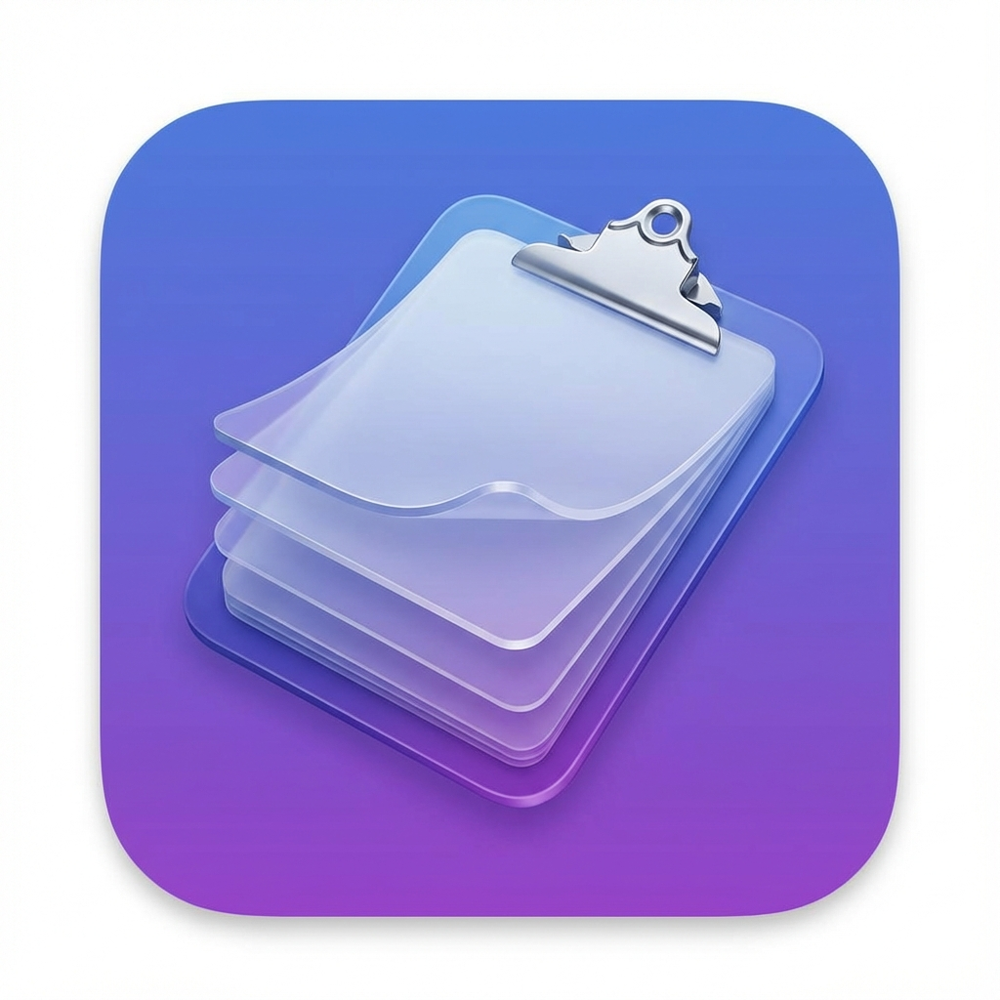

<p align="center">
  
</p>

<h1 align="center">ClipStash</h1>

<p align="center">
  <strong>🗒️ Lightweight, privacy-first clipboard history manager for macOS</strong>
</p>

<p align="center">
  <a href="https://apps.apple.com/app/clipstash-pro/id6756281955"></a>
  <a href="https://www.producthunt.com/products/clipstash-macos-privacyfirst-clipboard"></a>
  <a href="https://github.com/KikuAI-Lab/ClipStash/actions"></a>
  <a href="LICENSE"></a>
  <a href="https://www.apple.com/macos/"></a>
</p>

<p align="center">
  <a href="https://apps.apple.com/app/clipstash-pro/id6756281955">App Store</a> •
  <a href="https://kikuai-lab.github.io/ClipStash">Website</a> •
  <a href="https://github.com/KikuAI-Lab/ClipStash/wiki">Documentation</a> •
  <a href="https://github.com/KikuAI-Lab/ClipStash/releases/latest/download/ClipStash.app.zip">Direct Download</a>
</p>

---

## Why ClipStash?

ClipStash is an open-source macOS clipboard history manager with local search,
pinned items, app filters, and file export. It has no built-in cloud sync. The
app sandbox entitlements do not enable network client or server access.

### Key Features

| Feature | Description |
|---------|-------------|
| **Local History** | Keep and search copied text and images on your Mac |
| **Markdown Export** | Export selected history to files in a folder you choose |
| **App Exclusions** | Skip configured applications and recognized sensitive clipboard types |
| **Pin & Organize** | Pin frequently used clips and filter by source app |
| **Image Support** | Capture, preview, and optionally export image files with their paths in Markdown |

Application attribution follows the observed foreground app. Exclusions and
sensitive-type checks are safeguards, not a guarantee that every password or
sensitive copy can be identified. Review stored content and exports before
sharing them.

## Choosing a Clipboard Manager

[Maccy](https://github.com/p0deje/Maccy),
[CopyQ](https://hluk.github.io/CopyQ/), and
[PasteBar](https://github.com/PasteBar/PasteBarApp) are alternatives worth checking
against your own workflow. Their export formats, licenses, and current prices
should be checked in their official documentation.

ClipStash's export produces local Markdown or plain text. With image export
enabled, it also copies images and lists their relative paths in Markdown. A
portable folder on disk does not establish that another application will import
its images or preserve every reference.

---

## Installation

### App Store (Recommended)

[](https://apps.apple.com/app/clipstash-pro/id6756281955)

### Direct Download

[⬇️ **Download ClipStash.app.zip**](https://github.com/KikuAI-Lab/ClipStash/releases/latest/download/ClipStash.app.zip)

1. Download and unzip
2. Run in Terminal: `xattr -cr ~/Downloads/ClipStash.app`
3. Move `ClipStash.app` to `/Applications` and launch

> **Why xattr?** macOS blocks apps not signed with Apple Developer ID. This command removes the quarantine flag. ClipStash is open-source — [verify the code](https://github.com/KikuAI-Lab/ClipStash).

### Build from Source

```bash
git clone https://github.com/KikuAI-Lab/ClipStash.git
cd ClipStash
open ClipStash.xcodeproj
# Build with ⌘B, Run with ⌘R
```

### Launch at Login

1. Move `ClipStash.app` to `/Applications`
2. Open Settings → Enable "Launch at Login"

> Note: Launch at login requires the app to be in `/Applications` (macOS restriction).

---

## Usage

### Keyboard Shortcuts

| Action | Shortcut |
|--------|----------|
| Open history | Click menu bar icon |
| Navigate | `↑` / `↓` |
| Copy to clipboard | `Enter` |
| Focus search | `⌘F` |
| Delete item | `⌘⌫` |
| Pin/unpin | `⌘P` |
| View full content | Double-click |

### Export Files for Later Use

1. Click **Export...** in popover
2. Select scope: Last 50/100/200/500, Today, Pinned, or by App
3. Choose format: Markdown (recommended)
4. Click **Export Now**

Large exports auto-split at a target of **~400K words**. This is ClipStash's
chunking setting; acceptance by another tool depends on that tool's current
limits and supported formats. NotebookLM ingestion has not been qualified here.
Image paths in Markdown refer to local files; images are not automatically uploaded.
Exported files are not encrypted; review them before sending them to any external
service.

## Settings

| Setting | Default | Description |
|---------|---------|-------------|
| History Limit | 500 | Max items to keep (100-50000) |
| Text Max Size | 500 KB | Skip text larger than this |
| Image Max Size | 10 MB | Skip images larger than this |
| Save Images | On | Also capture images |
| Deduplication | On | Skip duplicate content |
| Byte Preserve | Off | Keep exact whitespace |

### Ignore List

Add app bundle IDs to exclude from capture (e.g., `com.1password.1password`).

## Privacy

- **Network Sandbox**: App entitlements do not enable network client or server access
- **No Telemetry**: Zero analytics or tracking
- **Local Storage**: All data in `~/Library/Application Support/ClipStash`
- **Sensitive Content**: Automatically skips concealed/transient clipboard items
- **Pinning**: Keeps an item available; pinning does not encrypt its content

### Sensitive Content Detection

ClipStash respects macOS clipboard indicators:
- `org.nspasteboard.ConcealedType` — password managers
- `org.nspasteboard.TransientType` — temporary data

## Architecture

```
ClipStash/
├── App/           # Entry point, AppDelegate
├── Core/          # Business logic
│   ├── ClipboardMonitor.swift
│   ├── StorageManager.swift
│   └── ExportService.swift
├── UI/            # SwiftUI views
└── Utils/         # Helpers
```

### Why Polling?

macOS doesn't provide clipboard change notifications. We poll `NSPasteboard.changeCount` every 300ms with debounce — same approach used by established clipboard managers. This uses negligible CPU.

## FAQ

**Q: Why not use NSPasteboard notifications?**
A: macOS doesn't provide them. Polling is the only reliable method.

**Q: How do I exclude an app?**
A: Settings → Ignore List → Add bundle ID (e.g., `com.apple.keychainaccess`).

**Q: Where is data stored?**
A: `~/Library/Application Support/ClipStash/clipstash.db`

**Q: How to fully uninstall?**
A: Delete app + `rm -rf ~/Library/Application\ Support/ClipStash`

## Documentation

- [Getting Started](https://github.com/KikuAI-Lab/ClipStash/wiki/Getting-Started) — Installation & first steps
- [Configuration](https://github.com/KikuAI-Lab/ClipStash/wiki/Configuration) — All settings explained
- [Privacy & Security](https://github.com/KikuAI-Lab/ClipStash/wiki/Privacy-and-Security) — How data stays private
- [FAQ](https://github.com/KikuAI-Lab/ClipStash/wiki/FAQ) — Common questions
- [Troubleshooting](https://github.com/KikuAI-Lab/ClipStash/wiki/Troubleshooting) — Fix common issues
- [Comparison](https://github.com/KikuAI-Lab/ClipStash/wiki/Comparison) — vs Maccy, CopyQ, PasteBar

## Contributing

See [CONTRIBUTING.md](CONTRIBUTING.md).

## Follow the work

Project notes and new tools: [Telegram](https://t.me/kiku_ai) ·
[LinkedIn](https://www.linkedin.com/in/kiku-jw/) ·
[KikuAI](https://kikuai.dev/)

## License

AGPL-3.0. Copyright (c) 2025 KikuAI Lab

<!-- author-links:start -->
<p align="center">
  <a href="https://kikuai.dev/"></a>
  <a href="https://t.me/kiku_ai"></a>
  <a href="https://github.com/kiku-jw"></a>
</p>
<p align="center">
  <sub>Follow new projects and updates from <a href="https://github.com/kiku-jw">@kiku-jw</a>.</sub>
</p>
<!-- author-links:end -->
