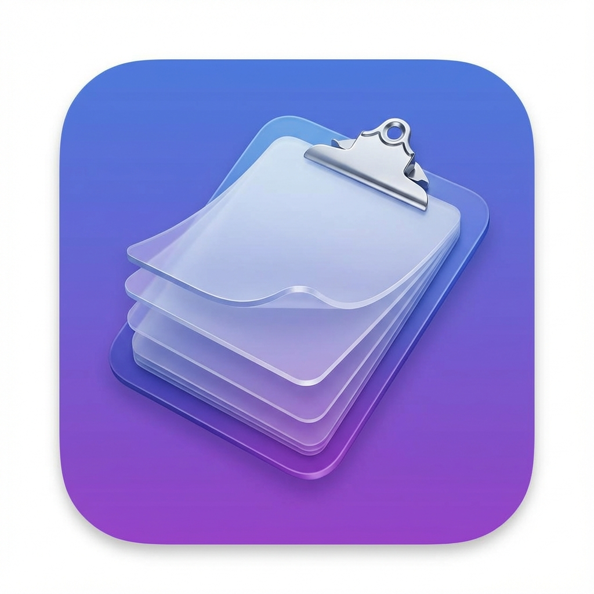

<p align="center">
  
</p>

<h1 align="center">ClipStash</h1>

<p align="center">
  <strong>Local-first clipboard history manager for macOS</strong>
</p>

<p align="center">
  <a href="https://apps.apple.com/app/clipstash-pro/id6756281955"></a>
  <a href="https://github.com/kiku-jw/ClipStash/actions"></a>
  <a href="LICENSE"></a>
  <a href="https://www.apple.com/macos/"></a>
</p>

Search copied text, keep useful snippets, and export selected clipboard history
as Markdown or plain text. ClipStash uses native SwiftUI and local SQLite
storage rather than an account-based clipboard service.

**[App Store listing](https://apps.apple.com/app/clipstash-pro/id6756281955)** ·
[GitHub releases](https://github.com/kiku-jw/ClipStash/releases) ·
[Build from source](#build-from-source) · [Privacy and limitations](#privacy-and-limitations)

## What it does

| Capability | Scope |
| --- | --- |
| Clipboard history | Text and supported images, with configurable size and history limits |
| Search | SQLite-backed history with FTS5 support |
| Pin and organize | Keep frequently used clips and filter by source app |
| Export | Markdown or plain-text files from recent, pinned, selected, or app-filtered history |
| Sensitive-item controls | Respect concealed/transient pasteboard flags when enabled; exclude configured app bundle IDs |
| Duplicate handling | Optional content-hash deduplication and whitespace-preservation setting |

ClipStash is a clipboard utility, not a password manager or a guarantee that
all sensitive material will be detected. No reproducible cross-application
benchmark is included here, so this README does not claim a fixed memory/CPU
budget, unique market position, or superiority over other clipboard managers.

## Installation

### App Store

Open the [App Store listing](https://apps.apple.com/app/clipstash-pro/id6756281955)
to check the version, availability, and requirements for your storefront.

### GitHub releases

Use the [release page](https://github.com/kiku-jw/ClipStash/releases) to inspect
the tag, release notes, and attached archive before downloading. A historical
archive is not necessarily the same code as the current default branch or the
App Store build.

Check the origin and signing information of the exact app you install. Do not
automatically clear quarantine attributes or disable macOS security checks to
open an unverified archive. Use the App Store route or build the source you
have reviewed when an archive's provenance is unclear.

### Build from source

The project declares macOS 14.0 or later. See
[CONTRIBUTING.md](CONTRIBUTING.md) for the development setup.

```bash
git clone https://github.com/kiku-jw/ClipStash.git
cd ClipStash
open ClipStash.xcodeproj
```

Select the ClipStash scheme in Xcode, build with `⌘B`, and run with `⌘R`.

### Launch at login

Move the app to `/Applications`, then enable **Launch at Login** in Settings.

## Usage

Copy a non-sensitive test sentence, open the menu-bar history, search for it,
and copy it back. Review the history and ignore-list settings before using the
app with work or personal material.

### Keyboard shortcuts

| Action | Shortcut |
| --- | --- |
| Open history | Click menu bar icon |
| Navigate | `↑` / `↓` |
| Copy to clipboard | `Enter` |
| Focus search | `⌘F` |
| Delete item | `⌘⌫` |
| Pin/unpin | `⌘P` |
| View full content | Double-click |

### Export for notes or an AI notebook

1. Click **Export...** in the popover.
2. Choose the history scope and Markdown or plain-text format.
3. Export, then inspect the files before sharing them with another service.

The current exporter targets approximately 400,000 words per chunk. This is a
local implementation setting, not a guarantee that a third-party service will
accept every exported file. Check that service's current limits yourself.
ClipStash writes the export locally; uploading it to NotebookLM or any other
service is a separate action with that service's own privacy terms.

## Settings

These defaults are defined in
[`AppSettings`](ClipStash/Core/Models/Settings.swift).

| Setting | Default | Description |
| --- | --- | --- |
| History limit | 500 | Maximum items; configurable from 100 to 50,000 |
| Text max size | 500,000 bytes | Skip larger text items |
| Image max size | 10,000,000 bytes | Skip larger images |
| Save images | On | Capture supported clipboard images |
| Deduplication | On | Skip duplicate content |
| Byte preserve | Off | Keep whitespace instead of trimming text |
| Ignore concealed items | On | Respect `org.nspasteboard.ConcealedType` |
| Ignore transient items | On | Respect `org.nspasteboard.TransientType` |

Add app bundle IDs to the ignore list, for example
`com.1password.1password`. The check uses the frontmost app's bundle ID;
it is not a universal detector of which application originally created data.

## Privacy and limitations

The clipboard monitor, storage, and exporter implement a local workflow.
However, **local-first is not a claim that every distributed build has a
verified network-denying sandbox**. Inspect the configuration and entitlements
of the exact signed binary before relying on that property. This README does
not attest to an App Store or GitHub archive's runtime behavior.

Sensitive-item skipping depends on the corresponding settings and on the
source application marking the pasteboard. Unmarked passwords, tokens, private
messages, and other confidential text can still enter history. Review history,
configure exclusions, and avoid copying secrets while recording.

The current storage code places `clipstash.db` and its `images` directory in a
`ClipStash` subdirectory of the app's Application Support directory. Its full
path can differ by build and sandbox container. Local storage and exported
files should be treated as sensitive; do not attach real clipboard databases,
exports, screenshots, or secrets to public issues.

### Removing local data

Quit ClipStash and export anything you intend to keep first. Remove the app
and, only after locating and checking its actual data directory, delete the
associated clipboard data. Deleting the database or images is destructive;
removing the app alone should not be assumed to erase all saved data or exports.

## Source and verification

| Area | Source |
| --- | --- |
| Pasteboard polling, size checks, sensitive flags, app exclusions | [`ClipboardMonitor.swift`](ClipStash/Core/ClipboardMonitor.swift) |
| SQLite database and storage location | [`StorageManager.swift`](ClipStash/Core/StorageManager.swift) |
| Export scopes, formats, and chunk target | [`ExportService.swift`](ClipStash/Core/ExportService.swift) |
| Settings and defaults | [`Settings.swift`](ClipStash/Core/Models/Settings.swift) |
| Build configuration | [`project.pbxproj`](ClipStash.xcodeproj/project.pbxproj) |
| Build and test commands | [CI workflow](.github/workflows/ci.yml) |

The monitor checks `NSPasteboard.changeCount` on a 0.3-second timer and applies
a separate debounce. These are implementation details, not a performance
benchmark. Source checks and CI builds do not replace testing an installed,
signed distribution artifact.

## Documentation and contributing

[Project wiki](https://github.com/kiku-jw/ClipStash/wiki) ·
[Contributing](CONTRIBUTING.md) ·
[Code of conduct](CODE_OF_CONDUCT.md) ·
[Report a reproducible issue](https://github.com/kiku-jw/ClipStash/issues)

Use synthetic text when reporting clipboard problems. Include the app version,
macOS version, and minimal reproduction steps, without private clipboard data.

## Follow the work

Project notes and new tools: [Telegram](https://t.me/kiku_ai) ·
[LinkedIn](https://www.linkedin.com/in/kiku-jw/) ·
[KikuAI](https://kikuai.dev/)

## License

The current checkout uses [AGPL-3.0](LICENSE). Check the license accompanying the
particular source revision or release you use.

<!-- author-links:start -->
<p align="center">
  <a href="https://kikuai.dev/"></a>
  <a href="https://t.me/kiku_ai"></a>
  <a href="https://github.com/kiku-jw"></a>
</p>
<p align="center">
  <sub>Follow new projects and updates from <a href="https://github.com/kiku-jw">@kiku-jw</a>.</sub>
</p>
<!-- author-links:end -->
